<div align="center">



### Engineering software that solves real problems.

**Senior Software Engineer · Full-Stack Product Engineer · Founder & CTO · Coding Mentor**

I design, build, secure and deploy production web and mobile applications — from architecture and database modelling to infrastructure and user experience.

[](https://awofesobipeaceportfolio.netlify.app/)
[](https://eduvate.com.ng)
[](https://linkedin.com/in/peace-kolade-58a27a314)
[](mailto:awofesobipeace@gmail.com)

</div>

---

## 01 / About me

I'm **Awofesobi Peace Kolade (CODEMaster)**, a Nigerian full-stack software engineer, technical founder, educator and first-class Electrical & Electronic Engineering graduate from **Osun State University**.

My work covers **PHP-based systems, relational databases, REST APIs, frontend interfaces, mobile applications, AI integrations and cloud/VPS deployment**. I enjoy taking products across the entire engineering lifecycle: requirements → architecture → implementation → security → production → iteration.


> **Engineering philosophy:** design for actual users, write maintainable software, prioritize security, and ship systems that remain useful after launch.

## 02 / Languages, frameworks & tools

My strongest hands-on area is **PHP + MySQL + JavaScript full-stack development**, supported by the following technologies used across projects, experiments and production deployments.

### Programming languages & core web technologies


### Backend engineering


**Implemented:** modular MVC applications, database schema design, prepared SQL statements, RBAC, authentication, CSRF protection, file uploads, billing/payment flows, webhooks, queues and cron jobs.

### Frontend, UI & animation


**Also:** DataTables · Swiper · Font Awesome · responsive layouts · dashboard design · animations and transitions.

### Mobile engineering & AI


**Implemented:** mobile API integration, OTP flows, push notifications, FCM v1, AI-supported explanations, question-formatting workflows and vision-assisted exam proctoring.

### Servers, infrastructure & developer workflow


**Operational experience:** Hostinger VPS · Ubuntu Linux · Nginx + PHP-FPM · SSH · Certbot SSL · Cloudflare DNS · SMTP, SPF/DKIM/DMARC · Git workflows · server debugging · automated scheduled tasks.

### Engineering specializations

| Architecture & backend | Product & UI | Security & operations |
| :--- | :--- | :--- |
| Custom PHP MVC, REST APIs | Responsive web applications | CSRF and input validation |
| Relational data modelling | React and React Native | Authorization and role guards |
| Database-driven dashboards | Motion/interactive interfaces | Prepared statements and secure sessions |
| Payments, webhooks, SMTP | CBT/LMS product workflows | VPS deployments and server configuration |
| Third-party integrations | Analytics and reporting | HTTPS, background jobs and troubleshooting |

---

## 03 / Flagship product — EDUVATE CBT

**Founder & CTO · Full-stack product architect · Lead engineer**

[](https://eduvate.com.ng)
[](https://play.google.com/store/apps/details?id=com.eduvate.practicehub)
[](https://youtu.be/raULhwC4TtE)
[](https://youtu.be/Qlz04x5xMz0)

**EDUVATE CBT** is an AI-enhanced educational ecosystem for institutions, teachers and students. I developed its core product architecture, exam engine, web workflows, dashboards, API integrations and companion React Native application.

| Product area | Engineering delivery |
| :--- | :--- |
| **CBT / assessment** | Timed and randomized exams, question banks, multiple answer formats, access controls, grading and controlled result publication |
| **LMS** | Courses, assignments, live learning, attendance and gradebook workflows |
| **Practice Hub** | Exam-preparation practice, AI explanations, personalized learning and student analytics |
| **Exam integrity** | Google Cloud Vision-assisted proctoring, configurable monitoring and review evidence |
| **Mobile** | React Native + Expo student learning application, API connectivity and notifications |
| **Institutional tooling** | Admin/teacher dashboards, subscription flows, reporting, bulk onboarding and email workflows |

**Architecture in practice**

```text
Students / Teachers / Institution Administrators
                        │
           Web Platform + Mobile App
                        │
            Authentication & RBAC
                        │
         Exams / LMS / Practice / Analytics
                        │
            PHP Services + MySQL
                        │
    Gemini · Cloud Vision · Payments · SMTP · FCM
                        │
          Ubuntu VPS + Nginx + PHP-FPM
```

This is a real production product serving educational workflows, not a tutorial or demonstration project.

---

## 04 / Selected shipped work

| Project | Engineering focus | Product |
| :--- | :--- | :--- |
| **Wanies Furniture** | Custom PHP MVC, catalogues, enquiry and admin workflows | [Website](https://waniesfurniture.com) |
| **Woods Heritage** | AgriTech web experience, motion, UI and PHP | [Website](https://www.woodsheritage.com.ng/) |
| **G&P Kitchen** | Ordering/catering experience, PHP and MySQL | [Website](https://gnpkitchen.co.uk/) |
| **True Match Online** | Matching platform, privacy-oriented workflows | [Website](https://www.truematchonline.com) |
| **Career Elevate** | Recruitment application workflows and administration | [Website](https://careerelevate.org) |
| **The Southwest Realtor** | Listings, CMS and WhatsApp lead handoff | [Website](https://www.thesouthwestrealtor.com) |
| **Landlady NG** | Property catalogue and enquiry flows | [Website](https://www.yourlandladyng.com) |

Some client work is proprietary and is showcased through deployed products rather than public source repositories.

[](https://github.com/CODEMaster-284?tab=repositories)

---

## 05 / Leadership, teaching & research

| Experience | Focus |
| :--- | :--- |
| **Founder & CTO — EDUVATE CBT** | Product strategy, engineering architecture, platform development and technical delivery |
| **Senior Software Engineer & Coding Mentor — Microtech Africa** | Engineering, developer mentoring and practical technical workshops |
| **Coding Instructor — Codingal** | Grade 4–12 programming education, assignments and guided projects |
| **IT Lead — University of Ilorin Postgraduate School (NYSC)** | IT support, operations and digital workflow assistance |
| **IT Tutor / Volunteer — OIC Hub** | Coding education and community technology outreach |

### Academic foundation

- **B.Eng. Electrical & Electronic Engineering**, Osun State University — **First Class, CGPA 4.70/5.00**.
- Academic recognitions include the **MICCOM Prize**, **Nigerian Society of Engineers (NSE) Best Graduating Student Award** and **First Class Graduate Award (2023/2024)**.
- Research interests: **AI in education, reliable assessment systems, educational technology, software engineering and intelligent learning systems**.
- Research work: *Development and evaluation of EDUVATE CBT as an integrated artificial intelligence powered assessment ecosystem.*

---

## 06 / Engineering principles

- **End-to-end ownership:** I work across design, implementation, deployment and ongoing operation.
- **Security is foundational:** Authentication, authorization, data integrity and safe integration practices are built into system design.
- **Clarity beats complexity:** Modularity, documented interfaces and understandable workflows matter.
- **Product thinking:** Good architecture must make real users' lives easier.
- **Knowledge sharing:** Technical mentoring, accessible explanations and practical developer education are part of my work.

---

## 07 / GitHub activity

<div align="center">


<picture>
  <source media="(prefers-color-scheme: dark)" srcset="https://raw.githubusercontent.com/CODEMaster-284/CODEMaster-284/output/github-contribution-grid-snake-dark.svg" />
  <source media="(prefers-color-scheme: light)" srcset="https://raw.githubusercontent.com/CODEMaster-284/CODEMaster-284/output/github-contribution-grid-snake.svg" />
  
</picture>

<sub>THE GRAPH IS NOT THE WORK. IT IS THE TRACE THE WORK LEAVES BEHIND.</sub>

</div>

---

<div align="center">

## 08 / Let's engineer something meaningful

**Software engineering · Product collaboration · EdTech partnerships · Developer mentorship**

[](mailto:awofesobipeace@gmail.com)
[](https://linkedin.com/in/peace-kolade-58a27a314)
[](https://medium.com/@awofesobipeace)

<sub>AWOFESOBI PEACE KOLADE · CODEMASTER · BUILD WITH PURPOSE</sub>

</div>
